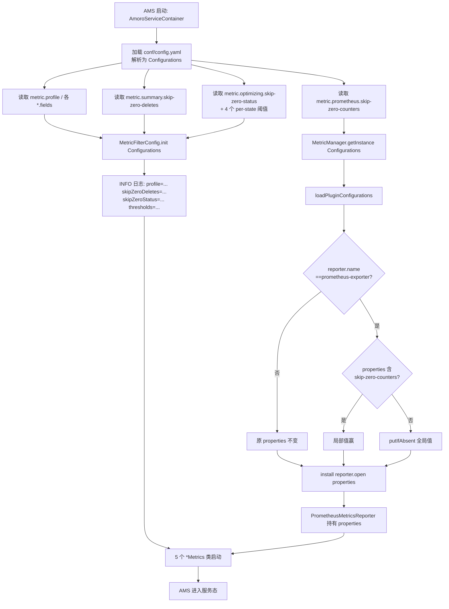
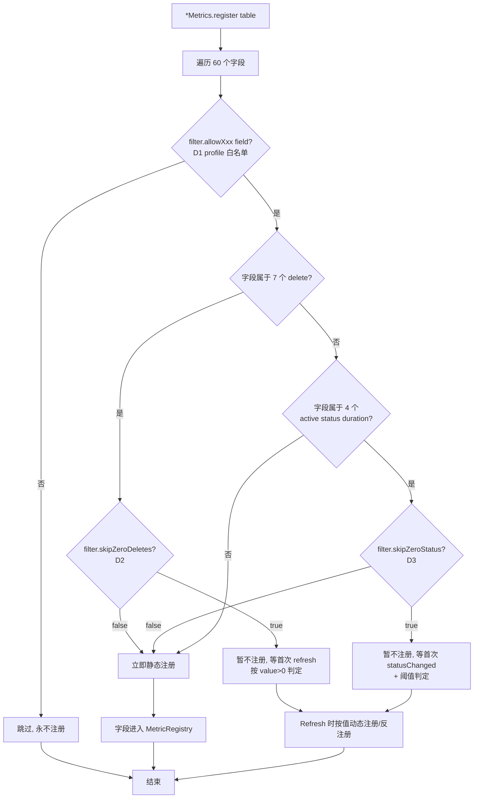
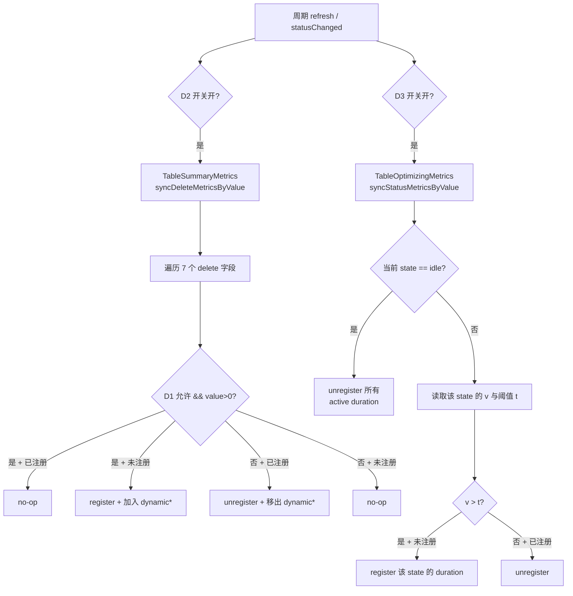
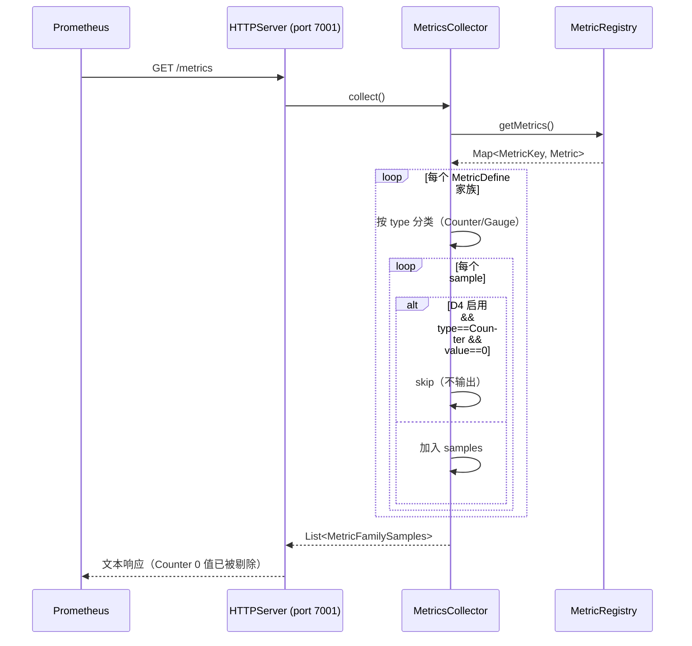
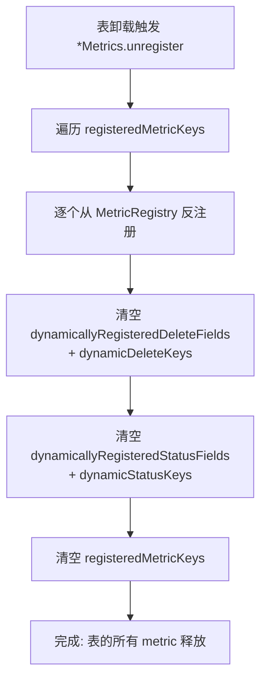

# AMS 指标体系过滤设计（统一设计文档）

> 项目：`amoro` (AMS) — 分支 `hotfix/tclake-amoro-20260529`
> 作者：Codebuddy 协助
> 日期：2026-06-02
> 状态：统一设计文档（D2/D3/D4 子方案的详细设计已并入本文，子文档已下线）
>
> **本文档的定位**：这是 AMS 指标过滤体系的**唯一权威设计文档**，把 4 个独立维度
> 收敛到一处，覆盖整体架构、配置矩阵、正交性证明、端到端流程、字段级判定、
> 状态机、任务拆分与风险分析。维度 1（profile 白名单）的字段级矩阵与容量推算
> 仍以 D1 主文档作为权威细节来源：
>
> | 引用文档 | 维度 | 章节锚点 |
> |---|---|---|
> | [`2026-05-29-AMS指标体系精简.md`](./2026-05-29-AMS指标体系精简.md) | 维度 1：`metric.profile` 白名单 | §3 全字段判定、§4.4 字段级 profile 矩阵、§5 容量推算 |
> | 维度 2：`metric.summary.skip-zero-deletes` | 详见本文 §2.3 / §3.2 / §3.3 / §4 / §5.2 | — |
> | 维度 3：`metric.optimizing.skip-zero-status` + per-state thresholds | 详见本文 §2.4 / §3.2 / §3.3 / §4 / §5.2 | — |
> | 维度 4：`metric.prometheus.skip-zero-counters` | 详见本文 §2.5 / §3.4 / §4 / §5.2 | — |

---

## 第 1 章：设计目的

### 1.1 背景

AMS（Amoro Management Service）的 metrics 表面共 **60 个 `MetricDefine`** 分布在 5 个源类
（`AmsServiceMetrics` 8 / `OptimizerGroupMetrics` 10 / `TableOptimizingMetrics` 23 /
`TableSummaryMetrics` 15 / `TableOrphanFilesCleaningMetrics` 4），其中 42 个 per-table
指标在 100k 表规模下放大为约 **400 万** metric instance：

```
100,000 × (23 + 15 + 4) = 4,200,000 per-table metric instance
```

直接消费方（Prometheus / Grafana / 内部告警）在 100k 表规模下面临三类典型问题：

1. **大量恒为 0 的稀疏 series**：非 keyed 表（占 60%-90%）的 7 个 delete 类指标长期为 0；
   从未发生过 process / failed 事件的表的 8 个 Counter 类指标长期为 0；处于 idle 状态的
   表的所有 status 类指标都是稳定无变化的稳态值。
2. **指标多但信号重复**：`status_in_*`（5 个 Gauge 0/1 指示器）与 `status_*_duration_mills`
   （5 个 Gauge 时长）严格同向，前者完全可由后者推导（`duration > 0 ⇔ in_state == 1`）；
   `total_files` / `data_files` / `snapshots` 等容量指标可由 AMS REST API 与底层 catalog
   直接获取，不必额外通过 Prometheus 通道发布。
3. **告警阈值表达力不足**：`status_in_executing == 1` 这种 0/1 信号无法直接表达
   "executing 卡顿超过 1 小时"这种业务诉求；duration 类指标加上"per-state 阈值过滤"才是
   告警的最佳载体。

### 1.2 目标

把 AMS 的指标过滤抽象为 **4 个正交、可组合、默认安全（不破坏现有行为）的维度**：

| # | 维度 | 配置项 | 作用层 | 默认值 | 收益 |
|---|---|---|---|:---:|---|
| D1 | profile 白名单 | `metric.profile` | `MetricRegistry` 注册端 | `legacy` | 字段级裁剪：每张表少注册 K 个 metric instance（K 取决于 profile） |
| D2 | summary delete 按值过滤 | `metric.summary.skip-zero-deletes` | `MetricRegistry` 注册端 | `false` | 7 个 delete Gauge 仅在值 > 0 时注册；非 keyed 表节省 ~7 series/表 |
| D3 | optimizing status 按值/阈值过滤 | `metric.optimizing.skip-zero-status` + 4 个 `metric.optimizing.status-duration-threshold-mills.<state>` | `MetricRegistry` 注册端 | `false`；阈值默认 0 | 5 个 status duration Gauge 仅在该状态当前活跃且时长越过阈值时注册；典型每表 0-1 series |
| D4 | prometheus counter 按值过滤 | `metric.prometheus.skip-zero-counters` | Prometheus reporter scrape 端 | `false` | 8 个 Counter 在当前累计值 == 0 时不进入 `/metrics` 输出；不影响 AMS 内存 |

### 1.3 设计原则

- **正交性**：4 个维度各自独立判断，无短路、无依赖。一个字段是否最终出现在
  Prometheus 输出中，由"profile 是否允许 → 注册端按值过滤是否放行 → scrape 端按值过滤
  是否放行"三层依次决定，每一层都是 AND 关系。
- **默认零变更**：四个开关默认值合起来等价于社区原始行为字节级一致；用户需显式开启才生效。
- **零数据迁移、可热回滚**：任意维度的配置回滚仅需修改 `conf/config.yaml` 并重启 AMS；
  无 DB schema 变更、无 Thrift / REST API 变更。
- **分层归属**：D1/D2/D3 是 AMS 进程内部的注册控制，统一收敛到 `MetricFilterConfig`
  （singleton），实现于 `amoro-ams` 模块；D4 是 Prometheus reporter 的展示控制，实现于
  `amoro-metrics-prometheus` 模块，通过 `MetricManager` 装配阶段以
  `putIfAbsent` 语义把全局值注入 reporter properties。

### 1.4 非目标

- ❌ **不**改变指标语义：metric 名称、tag schema、值计算逻辑均不变。
- ❌ **不**修改 `MetricsCollector` / `PrometheusMetricsReporter` 的核心 scrape 流程
  （仅在 D4 维度新增一个 boolean 过滤分支）。
- ❌ **不**对所有指标都做按值过滤：聚合健康类指标（如 `health_score`）即使为 0 也具有
  告警价值，明确排除在 D2/D3 之外。
- ❌ **不**把过滤逻辑下沉到 `MetricRegistry` 通用层：D4 严格限定在 prometheus reporter
  内部，避免影响其他 reporter（OpenTelemetry / StatsD / 未来扩展）。
- ❌ **不**与 profile 联动按值过滤的默认值：D2/D3/D4 在所有 profile 下默认都是 `false`。

---

## 第 2 章：设计方案

### 2.1 整体架构

```
                        +-------------------------------------------------+
                        |  conf/config.yaml  (AMS 服务全局配置)            |
                        |  metric:                                         |
                        |    profile: recommended | minimal | legacy | ... |
                        |    summary.skip-zero-deletes: false              |
                        |    optimizing.skip-zero-status: false            |
                        |    optimizing.status-duration-threshold-mills:   |
                        |      pending: 0  planning: 0  executing: 0  ...  |
                        |    prometheus.skip-zero-counters: false          |
                        +------------------------+-------------------------+
                                                 | AmoroServiceContainer 启动时加载
                                                 v
+----------------------+    inject    +-----------------------+    inject (D4)   +----------------------+
| MetricFilterConfig   | <----------- | AmoroManagementConf   | ---------------> | MetricManager        |
|  (singleton)         |              |  (ConfigOption defs)  |                  |  (装配 reporter      |
|  - profile           |              +-----------------------+                  |   properties)        |
|  - whitelist sets    |                                                         +----------+-----------+
|  - skipZeroDeletes   |                                                                    |
|  - skipZeroStatus    |                                                                    | putIfAbsent
|  - thresholds        |                                                                    v
+----------+-----------+                                              +-------------------------------+
           | 读取                                                     | PrometheusMetricsReporter     |
           v                                                          |   properties:                 |
+--------------------------------+                                    |     skip-zero-counters=...    |
| 5 个 *Metrics 类               |  register / unregister             +---------------+---------------+
|  AmsServiceMetrics             | -----------------------+                           |
|  OptimizerGroupMetrics         |                        |                           v
|  TableOptimizingMetrics  (D3) |                        v          +-------------------------------+
|  TableSummaryMetrics     (D2) |             +--------------------+| MetricsCollector              |
|  TableOrphanFilesCleaningMetrics             | MetricRegistry     ||  - skipZeroCounters (D4)      |
+--------------------------------+             |  (ConcurrentMap)   ||  - createFamilySample()       |
                                               +---------+----------+|    if D4 && Counter && v==0:  |
                                                         |           |      skip                     |
                                                         |           +---------------+---------------+
                                                         | getMetrics()              |
                                                         +-------------------------->+
                                                                                     |
                                                                                     v
                                                          +--------------------------+--+
                                                          |  HTTP /metrics 文本输出      |
                                                          |  (外部 Prometheus pull)      |
                                                          +------------------------------+
```

四个维度按"配置文件 → 单例（D1/D2/D3） + reporter properties（D4） → 各 metric 类
的 register 路径 / scrape 路径"统一注入，过滤决策点收敛到 4 处：

| 维度 | 决策点 | 触发时机 |
|---|---|---|
| D1 | `MetricFilterConfig.allowXxx(field)` | 每个 metric 类的 `register()` 入口对每个字段判断一次 |
| D2 | `TableSummaryMetrics.syncDeleteMetricsByValue()` | 每次 `refresh(input)` 调用结束 |
| D3 | `TableOptimizingMetrics.syncStatusMetricsByValue()` | `DefaultOptimizingState.statusChanged()` 与周期 refresh 末尾 |
| D4 | `MetricsCollector.createFamilySample()` | 每次 Prometheus scrape `/metrics` |

### 2.2 维度 1：`metric.profile` —— 字段白名单

**详见 [`2026-05-29-AMS指标体系精简.md`](./2026-05-29-AMS指标体系精简.md) 第 3-5 章。**

#### 2.2.1 4 个 profile 简表

| profile | 注册字段数（共 60）| 适用场景 |
|---|---:|---|
| `legacy` | 60 | 与社区行为完全一致；新分支默认值 |
| `recommended` | 29 | 通用生产推荐；舍弃容量类与冗余 status 指示器 |
| `minimal` | 19 | ≥ 100k 表的极端规模；进一步舍弃 freshness/lag/health_score 等非 action-driving 字段 |
| `custom` | 由 4 个 `*.fields` 列表完全决定 | 高级用户精确选取 |

> 跨 4 个开关、跨 4 个 profile 的字段级矩阵以
> [`2026-05-29-AMS指标体系精简.md`](./2026-05-29-AMS指标体系精简.md) §4.4 为准；最近一次
> 字段调整（2026-06-02：从 `recommended`/`minimal` 移除 `status_idle_duration`）也已落入
> 该文档 Revision History。

#### 2.2.2 实现要点

- 配置项：`metric.profile`（顶层，`String`，默认 `legacy`）+ 4 个 `metric.<group>.fields`
  列表（`profile=custom` 时使用）。
- 单例：`MetricFilterConfig`（位于 `amoro-ams/.../metrics/`），`init(Configurations)` 在
  `AmoroServiceContainer` 启动时执行；启动日志 INFO 输出 profile 与各开关值。
- 每个 metric 类的 `register(...)` 通过私有 helper 走
  `if (filter.allowXxx(field)) registry.register(...)`，未通过的字段一概不注册。
- 字段常量 `F_*` 与 `MetricDefine` 全部保留（即便不被 profile 选中也保留代码对象，便于
  `custom` 用户精确选取）。

### 2.3 维度 2：`metric.summary.skip-zero-deletes` —— delete Gauge 按值过滤

#### 2.3.1 适用范围

仅作用于 `TableSummaryMetrics` 中 7 个 delete 相关 Gauge：

| Field 常量 | metric 名称 | 过滤判断条件（自身值） |
|---|---|---|
| `F_SUMMARY_EQUALITY_DELETE_FILES` | `table_summary_equality_delete_files` | `equalityDeleteFileCount == 0` |
| `F_SUMMARY_POSITION_DELETE_FILES` | `table_summary_position_delete_files` | `positionalDeleteFileCount == 0` |
| `F_SUMMARY_DANGLING_DELETE_FILES` | `table_summary_dangling_delete_files` | `danglingDeleteFileCount == 0` |
| `F_SUMMARY_EQUALITY_DELETE_FILES_SIZE` | `table_summary_equality_delete_files_size` | `equalityDeleteBytes == 0` |
| `F_SUMMARY_POSITION_DELETE_FILES_SIZE` | `table_summary_position_delete_files_size` | `positionalDeleteBytes == 0` |
| `F_SUMMARY_EQUALITY_DELETE_FILES_RECORDS` | `table_summary_equality_delete_files_records` | `equalityDeleteFileRecords == 0` |
| `F_SUMMARY_POSITION_DELETE_FILES_RECORDS` | `table_summary_position_delete_files_records` | `positionalDeleteFileRecords == 0` |

> `health_score` **不在过滤范围**：聚合健康指标本就用于"健康表也有读数"，不能按 0 过滤。

#### 2.3.2 状态机（每个字段独立运行）

```
 ┌──────────────┐   value > 0 / register   ┌──────────────┐
 │ NotRegistered│ ──────────────────────>  │  Registered  │
 │              │ <──────────────────────  │              │
 └──────────────┘   value == 0 / unregister└──────────────┘
        ^                                          ^
        │ value 持续为 0（无操作）                │ value 在非零之间变化（无操作，gauge 自动取新值）
```

#### 2.3.3 实现要点

- 引入 `DELETE_METRIC_SPECS`（`LinkedHashMap<String, DeleteMetricSpec>`）静态映射，封装
  `(MetricDefine, valueExtractor, metricFactory)` 三元组。
- 实例字段 `dynamicallyRegisteredDeleteFields: Set<String>` 与
  `dynamicDeleteKeys: Map<String, MetricKey>` 跟踪运行时状态；每次动态 register 时同步
  加入 `registeredMetricKeys`，使既有 `unregister()` 路径一并兜底。
- 在 `refresh(PendingInput)` 末尾、且 `filter.isSkipZeroDeletes()` 为 true 时调用
  `syncDeleteMetricsByValue()`。
- `register()` 入口逻辑：profile 不允许 → 跳过；profile 允许 + 开关关 → 立即静态注册
  （与社区一致）；profile 允许 + 开关开 → 暂不注册，等待首次 refresh 按值判定。
- 与 D4 不同，本维度作用于注册端，**对所有 reporter 统一生效**。

### 2.4 维度 3：`metric.optimizing.skip-zero-status` + per-state 阈值 —— status duration 按值/阈值过滤

#### 2.4.1 适用范围

仅作用于 `TableOptimizingMetrics` 中 4 个 active-stage status duration Gauge
（`status_idle_duration` 不参与本机制——`idle` 是健康稳态）：

| Field 常量 | metric 名称 | 状态键 | per-state 阈值配置项 |
|---|---|---|---|
| `F_OPT_STATUS_PENDING_DURATION` | `table_optimizing_status_pending_duration_mills` | `pending` | `metric.optimizing.status-duration-threshold-mills.pending` |
| `F_OPT_STATUS_PLANNING_DURATION` | `table_optimizing_status_planning_duration_mills` | `planing` | `metric.optimizing.status-duration-threshold-mills.planing` |
| `F_OPT_STATUS_EXECUTING_DURATION` | `table_optimizing_status_executing_duration_mills` | `executing` | `metric.optimizing.status-duration-threshold-mills.executing` |
| `F_OPT_STATUS_COMMITTING_DURATION` | `table_optimizing_status_committing_duration_mills` | `committing` | `metric.optimizing.status-duration-threshold-mills.committing` |

> 5 个 `status_in_*` 指示器在 `recommended`/`minimal` profile 下被 D1 直接拒绝
> （详见主文档 §3.3）；`legacy` 下 `status_in_*` 仍受本机制按值（== 1）控制注册。

#### 2.4.2 过滤判定

```
对每张表当前唯一的活跃 status：
  if (skipZeroStatus == false) {
    所有 4 个 active duration 字段 eager 静态注册（与社区一致）
  } else {
    if (current_state == idle) { 全部不注册 }
    else {
      let v = duration_of(current_state)
      let t = threshold_of(current_state)   // 默认 0
      if (v > t) register(current_state_duration_field)
      其他 3 个 active duration 字段 unregister（如已注册）
    }
  }
```

#### 2.4.3 触发点

- `DefaultOptimizingState.statusChanged()` 末尾调用 `TableOptimizingMetrics.refresh()`
- `DefaultOptimizingState.refresh()` 末尾调用 `TableOptimizingMetrics.refresh()`
- 表卸载时 `unregister()` 一次性清理所有动态 status 注册

#### 2.4.4 与 D2 的对称性

D2/D3 是同模式：均为"`MetricFilterConfig` 增加开关字段 + `*Metrics` 类增加动态状态映射 +
在表周期 refresh 末尾调用 sync 方法 + `unregister()` 兜底清理"。两者唯一差异是 D3
额外读取 per-state 阈值，并且 status 之间是"互斥单选"（任意时刻最多 1 个 active
state），而 D2 的 7 个 delete 字段是"独立并存"。

### 2.5 维度 4：`metric.prometheus.skip-zero-counters` —— Counter scrape 端按值过滤

#### 2.5.1 适用范围

`TableOptimizingMetrics` 中 8 个 Counter（O11..O18：`process_total_count` /
`process_failed_count` / 4 个 type 子计数对），以及未来在 AMS 中以 `Counter` 类型注册的
任何字段。Gauge 一律不受本维度影响。

#### 2.5.2 设计选择：scrape 端而非注册端

- Counter 的累计值不能被"按值 unregister"：`unregister → register` 会重置累计，破坏
  Prometheus `rate()` / `increase()` 的语义。
- 因此本维度**不**在 `MetricRegistry` 注册端动作，而是在
  `PrometheusMetricsReporter` 的 `MetricsCollector.createFamilySample()` 内部，对
  `define.getType() == Counter && value == 0.0d` 的 sample 跳过输出。
- 副作用：**不节省 AMS 进程内存**（`MetricRegistry` 仍持有所有 Counter），但**显著节省**
  Prometheus 网络带宽 / TSDB 存储 / Grafana 索引（典型场景下 95%+ Counter 行被剔除）。

#### 2.5.3 配置注入路径

```
conf/config.yaml
  metric.prometheus.skip-zero-counters: true        ← 全局值 (D4-global)
                              │
                              │ AmoroServiceContainer.start()
                              ▼
  AmoroManagementConf 读取 → Configurations
                              │
                              │ 透传到
                              ▼
  MetricManager.loadPluginConfigurations()
    遍历所有 reporter，对 name == "prometheus-exporter" 的 reporter:
      props.putIfAbsent("skip-zero-counters", String.valueOf(global))
                              │
                              │ install → reporter.open(properties)
                              ▼
  PrometheusMetricsReporter
    private Map<String,String> properties;          ← 持有 properties
    setGlobalMetricSet(metrics):
      boolean v = Boolean.parseBoolean(properties.getOrDefault("skip-zero-counters","false"));
      new MetricsCollector(metrics, v).register();
```

**优先级**（`putIfAbsent` 语义，主流生态一致）：

```
plugins/metric-reporters.yaml 中 reporter.properties.skip-zero-counters
                  >  conf/config.yaml 中 metric.prometheus.skip-zero-counters
                  >  默认 false
```

> reporter 局部 properties **仅**作用于 `name == prometheus-exporter` 的 reporter；其他
> reporter（OpenTelemetry / StatsD / 未来扩展）完全不受影响。

### 2.6 配置一览表

| 配置项 | 类型 | 默认值 | 作用维度 | 作用层 |
|---|---|:---:|:---:|---|
| `metric.profile` | enum (`legacy`/`recommended`/`minimal`/`custom`) | `legacy` | D1 | 注册端 |
| `metric.optimizing.fields` | list | – | D1 (custom) | 注册端 |
| `metric.summary.fields` | list | – | D1 (custom) | 注册端 |
| `metric.orphan.fields` | list | – | D1 (custom) | 注册端 |
| `metric.group.fields` | list | – | D1 (custom) | 注册端 |
| `metric.summary.skip-zero-deletes` | boolean | `false` | D2 | 注册端 |
| `metric.optimizing.skip-zero-status` | boolean | `false` | D3 | 注册端 |
| `metric.optimizing.status-duration-threshold-mills.pending` | long (ms) | `0` | D3 | 注册端 |
| `metric.optimizing.status-duration-threshold-mills.planing` | long (ms) | `0` | D3 | 注册端 |
| `metric.optimizing.status-duration-threshold-mills.executing` | long (ms) | `0` | D3 | 注册端 |
| `metric.optimizing.status-duration-threshold-mills.committing` | long (ms) | `0` | D3 | 注册端 |
| `metric.prometheus.skip-zero-counters` | boolean | `false` | D4 | scrape 端 |
| `metric-reporters.yaml: properties.skip-zero-counters` | boolean | 继承 D4 全局值 | D4 | scrape 端（局部覆盖）|

YAML 推荐配置（生产典型，开启全部 4 个维度）：

```yaml
ams:
  metric:
    profile: recommended
    summary:
      skip-zero-deletes: true
    optimizing:
      skip-zero-status: true
      status-duration-threshold-mills:
        pending: 1800000        # 30 min
        planing: 300000         # 5 min
        executing: 3600000      # 1 hour
        committing: 600000      # 10 min
    prometheus:
      skip-zero-counters: true
```

### 2.7 接口与 DB 变更

- **不**涉及 DB schema 变更
- **不**涉及 REST API 变更
- **不**涉及 Thrift 接口变更
- 仅新增上述 ConfigOption；保持现有 `metric.*` 命名空间。

---

## 第 3 章：流程图

### 3.1 启动期：四开关注入流程



### 3.2 表注册期：各字段是否注册的判定（D1+D2+D3）



### 3.3 周期 refresh 期：D2/D3 同步流程



### 3.4 Prometheus scrape 期：D4 过滤流程



### 3.5 表卸载期：动态状态清理



> 关键不变量：D2/D3 的 dynamic 注册路径**必须**同步把新 `MetricKey` 写入
> `registeredMetricKeys`，使表卸载时既有的"全量反注册"逻辑天然兜底，避免 metric 泄漏。

---

## 第 4 章：任务拆分

> 4 个维度的代码落地任务已基本完成。本章给出**统一索引**，方便回顾全貌。

### 4.1 任务全景

| Phase | Task ID | 目标 | 来源章节 | 状态 |
|---|---|---|---|---|
| P1（D1 基础设施）| T1-T7 | profile 体系 + `MetricFilterConfig` + 4 个 metric 类的 register helper + 单测 + 文档 | 主文档 [`2026-05-29-AMS指标体系精简.md`](./2026-05-29-AMS指标体系精简.md) §6 | ✅ 已落地 |
| P1（D1 基础设施）| T8 | 集成测试（100 张表 N profile 下 scrape 行数）| 主文档 §6 | ✅ 已落地 |
| P1（D1 基础设施）| T9 | 端到端集成测试（100k 表压测）| 主文档 §6 | ⏸ 受 CI 镜像限制延后 |
| P1（D1 基础设施）| T10 | admin-guides 文档 | 主文档 §6 | ✅ 已落地 |
| P2（D2 delete 按值）| T1-T2 | 配置项 + `MetricFilterConfig` 扩展 | 本文 §2.3 | ✅ 已落地 |
| P2（D2 delete 按值）| T3 | `TableSummaryMetrics` 改造（`DELETE_METRIC_SPECS` + `syncDeleteMetricsByValue` + `refresh` 钩子）| 本文 §2.3 / §3.3 | ✅ 已落地 |
| P2（D2 delete 按值）| T4-T5 | 单测 | 本文 §4 | ✅ 已落地 |
| P2（D2 delete 按值）| T6 | 文档 | — | ✅ 已落地 |
| P2（D2 delete 按值）| T7 | 格式化与编译校验 | — | ✅ 已落地 |
| P3（D3 status 按值/阈值）| 6 个任务 | 配置项（6 项）+ `MetricFilterConfig` + `TableOptimizingMetrics` + `DefaultOptimizingState.statusChanged/refresh` 钩子 + 单测 + 文档 | 本文 §2.4 / §3.3 | ✅ 已落地 |
| P4（D4 Counter scrape）| Task 0 | 全局 ConfigOption + `MetricManager` 装配阶段 `putIfAbsent` 透传 | 本文 §2.5.3 | ⏸ Draft，待审 |
| P4（D4 Counter scrape）| Task 1 | `MetricsCollector` 加 `skipZeroCounters` 字段 + 过滤分支 | 本文 §2.5.2 | ⏸ Draft，待审 |
| P4（D4 Counter scrape）| Task 2 | `PrometheusMetricsReporter` 透传 properties | 本文 §2.5.3 | ⏸ Draft，待审 |
| P4（D4 Counter scrape）| Task 3 | 单测（覆盖 §3.4 矩阵）| 本文 §3.4 | ⏸ Draft，待审 |

### 4.2 后续任务（文档完善）

| 任务 | 改动文件 | 规模 |
|---|---|---|
| U2：在 `docs/admin-guides/configuring-metrics.md` 顶部增加"四维度概览"小节并交叉引用本文档 | `docs/admin-guides/configuring-metrics.md` | ≤ 30 行 |

> U2 是文档完整性建议，待用户确认是否执行。

---

## 第 5 章：风险与注意事项

### 5.1 跨维度风险（合并视角新增）

| # | 风险 | 触发条件 | 缓解措施 |
|---|---|---|---|
| GR1 | 操作员同时启用 4 个维度后心智负担过重 | 4 个开关 + 4 个 per-state 阈值 + per-reporter 局部覆盖 | 本统一文档 §2.6 / §3.1 提供单页配置矩阵 + 启动注入流程；admin-guides 增加 §1 "四维度概览" |
| GR2 | 4 个开关之间的优先级误解（"哪个赢"）| 用户预期 D4 全局 vs 局部 reporter 谁优先；预期 D1 vs D2/D3 谁先生效 | §3.2 流程图给出 AND 关系 + 决策顺序：D1 → (D2 or D3) → D4 |
| GR3 | 配置变更后启动日志缺失校验信息 | 用户改了 yaml，启动日志没确认新值生效 | `MetricFilterConfig.init()` 与 `MetricManager.loadPluginConfigurations()` 都需 INFO 输出最终生效值 |
| GR4 | D4 与 D2/D3 的"过滤层错位"被误用 | 期望"AMS 内存也省"却启用了 D4 | §1.2/§2.5.2 明确："D4 不省内存，仅省 scrape/存储" |
| GR5 | 多 prometheus reporter 实例下的差异化配置 | 同一 AMS 配多个 prometheus-exporter，期望部分实例保留 0 值用于调试 | §2.5.3 给出 reporter 局部 properties 覆盖示例（局部赢）|

### 5.2 各维度个体风险

逐项以原文档章节为权威来源，本节仅做一句总结：

- **D1 风险**：见 [`2026-05-29-AMS指标体系精简.md`](./2026-05-29-AMS指标体系精简.md) §6.2。核心：
  dashboards 依赖被裁剪字段时，需迁移到 `legacy` 或 `custom`。
- **D2 风险**（详见本文 §2.3）：series 在 0/非 0 之间会出现 / 消失；告警阈值需用
  `> 0` 而非 `absent()`；动态 register/unregister 的并发安全由 `MetricRegistry` 内部
  的 `ConcurrentMap` 保证，单表 refresh 由调度器串行调用。
- **D3 风险**（详见本文 §2.4）：per-state 阈值需操作员显式设置（默认 0 等价于
  "按值过滤"）；status 切换会触发动态 register/unregister，但频率受 optimizing 状态机
  限制（分钟级）；`status_in_*` 在 `recommended`/`minimal` 下被 D1 拒绝，`legacy` 下
  仍受本机制按值（== 1）控制注册。
- **D4 风险**（详见本文 §2.5）：`absent()` 类告警语义改变（启用前需把
  `absent(amoro_table_optimizing_process_failed_count_total)` 类查询改为 `... > 0`
  或 `rate(...) > 0`）；`rate()` / `increase()` 跨"0 值消失 → 首个非 0 出现"的边界
  由 Prometheus 自动 extrapolate 处理，无需操作员干预；本开关**仅**对 prometheus
  reporter 生效，其他 reporter 不受影响。

### 5.3 共性注意事项

1. **不要**在任意维度开启后假设"AMS 内存一定下降"——只有 D1/D2/D3 真正减少
   `MetricRegistry` 持有量；D4 只省 scrape/TSDB。
2. **不要**对 Gauge 类指标使用 D4 模型的过滤思路（D4 严格只针对 Counter）。
3. **不要**把 D2/D3 的过滤逻辑下沉到 `MetricRegistry` 通用层——会与未来 Counter 懒注册
   议题冲突，应保持各 `*Metrics` 类内部维护动态状态。
4. 所有维度均为**单次启动期固定**（配置不支持热更新），变更后需重启 AMS。

---

## 第 6 章：变更影响分析

### 6.1 代码影响面（合并后总览）

| 模块 | 文件 | 改动来源 | 状态 |
|---|---|---|---|
| `amoro-common` / `amoro-ams` | `AmoroManagementConf.java` | 新增 12+ 个 ConfigOption（D1: 5 / D2: 1 / D3: 5 / D4: 1）| ✅ 已落地 D1+D2+D3；D4 待审 |
| `amoro-ams` | `MetricFilterConfig.java`（新增）| D1 主体 + D2/D3 字段 | ✅ 已落地 |
| `amoro-ams` | `AmoroServiceContainer.java` | `MetricFilterConfig.init(serviceConfig)` 一行 | ✅ 已落地 |
| `amoro-ams` | `MetricManager.java` | D4 装配阶段 putIfAbsent | ⏸ 待 Task 0 落地 |
| `amoro-ams` | `TableSummaryMetrics.java` | D2 改造 | ✅ 已落地 |
| `amoro-ams` | `TableOptimizingMetrics.java` | D3 改造 | ✅ 已落地 |
| `amoro-ams` | `TableOrphanFilesCleaningMetrics.java` / `OptimizerGroupMetrics.java` / `AmsServiceMetrics.java` | D1 register helper | ✅ 已落地 |
| `amoro-ams` | `DefaultOptimizingState.java` | D3 触发钩子（`statusChanged()` + `refresh()` 末尾）| ✅ 已落地 |
| `amoro-metrics-prometheus` | `MetricsCollector.java` | D4 过滤分支 | ⏸ 待 Task 1 落地 |
| `amoro-metrics-prometheus` | `PrometheusMetricsReporter.java` | D4 properties 透传 | ⏸ 待 Task 2 落地 |
| `amoro-ams` 测试 | `TestMetricFilterConfig` / `TestTableSummaryMetricsSkipZeroDeletes` / `TestTableOptimizingMetricsSkipZeroStatus` / `TestSkipZeroStatusEndToEnd` | 单测 + 端到端 | ✅ 已落地 |
| `amoro-metrics-prometheus` 测试 | `TestMetricsCollectorSkipZeroCounters` 等 | D4 单测 | ⏸ 待 Task 3 落地 |
| 文档 | `docs/admin-guides/configuring-metrics.md` | 4 维度章节 | ✅ 已落地 D1+D2+D3；D4 待补 |

> 无 DB schema、无 Thrift / REST API、无业务调度链路改动。

### 6.2 容量影响（100k 表场景，合并表）

| 配置组合 | 注册条数 | `/metrics` 行数 | AMS 内存 | 与基线 `legacy` 相比 |
|---|---:|---:|---:|---|
| `legacy`（社区基线）| ~4,000,112 | ~4,000,112 | ~144 GB | 0% |
| `recommended` | ~1,500,092 | ~1,500,092 | ~26-38 GB | -62% 内存 -62% 行数 |
| `recommended` + D2 + D3 + D4 | ~1,500,092 | typical < 200,000 | ~26-38 GB | 内存同 recommended；scrape 行数 -95% |
| `minimal` | ~1,200,062 | ~1,200,062 | ~22-32 GB | -70% 内存 -70% 行数 |
| `minimal` + D2 + D3 + D4 | ~1,200,062 | typical < 100,000 | ~22-32 GB | 内存同 minimal；scrape 行数 -97% |

> "typical" 指生产场景中实际处于 active state 且越过阈值的表 + 实际有过 process 事件
> 的表占比小于 5% 的常见情形。具体推算见主文档 §5。

### 6.3 兼容性

| 维度 | 兼容性 |
|---|---|
| 配置文件 | 100% 向后兼容（4 个开关默认值合起来等价于社区原始行为）|
| 二进制接口 | 旧调用方无需改动；`MetricsCollector` 旧构造函数保留为 `this(metrics, false)` |
| 监控告警 | 默认关闭即兼容；启用后需操作员调整 `absent()` 类查询（D2/D4） |
| 跨 reporter | D1/D2/D3 对所有 reporter 一视同仁；D4 仅作用于 prometheus-exporter |
| 回滚 | 改一个 / 多个 yaml 键值并重启 AMS；零数据迁移 |

### 6.4 文档同步

- 本统一文档归档至 `docs/软件设计/2026-05-29-AMS指标体系精简/2026-06-02-AMS指标体系过滤设计.md`，
  作为指标过滤体系的**唯一权威设计文档**。
- 保留 D1 主文档 `2026-05-29-AMS指标体系精简.md` 作为字段级 profile 矩阵与容量推算的
  权威细节来源（其字段表是代码评审与回归测试的真值表）。
- D2/D3/D4 三份原始子文档（`2026-06-01-按值过滤delete指标.md`、
  `2026-06-01-TableOptimizing指标精简方案.md`、`2026-06-02-按值过滤Counter零值指标.md`）
  的核心内容已并入本文 §2.3/§2.4/§2.5 与 §3、§4、§5、§6 各章节，子文档已下线
  （归档于 git 历史中，commit 前可通过 `git log` 追溯）。
- 操作员文档：`docs/admin-guides/configuring-metrics.md` 已包含 D1+D2+D3 章节；
  D4 章节待 P4 任务落地后补充（U2 见 §4.2）。

### 6.5 回滚成本

任意维度独立回滚：

| 维度 | 回滚操作 | 数据迁移 |
|---|---|---|
| D1 | `metric.profile: legacy` → 重启 | 无 |
| D2 | `metric.summary.skip-zero-deletes: false` → 重启 | 无 |
| D3 | `metric.optimizing.skip-zero-status: false` → 重启 | 无 |
| D4 | `metric.prometheus.skip-zero-counters: false`（或删除该键 + 各 reporter `properties.skip-zero-counters`）→ 重启 | 无 |

四个维度同时回滚 = 全部还原社区基线行为。

---

## 附录 A：术语与缩写

| 术语 | 含义 |
|---|---|
| AMS | Amoro Management Service，本项目的核心管理进程 |
| `MetricRegistry` | AMS 内部的 metric 容器（`ConcurrentMap<MetricKey, Metric>`），所有 reporter 都通过 `getMetrics()` 拉快照 |
| `MetricFilterConfig` | 本设计引入的 singleton，承载 D1/D2/D3 配置 |
| profile | `metric.profile` 的取值（`legacy`/`recommended`/`minimal`/`custom`）|
| Group U / R | 主文档对字段的分组：U = `TableSummaryMetrics`、R = `TableOptimizingMetrics` 中的 status 子集 |
| scrape | Prometheus pull 模型下的"抓取"，即一次 `GET /metrics` |
| 注册端 vs scrape 端 | 注册端 = 进入 `MetricRegistry` 之前的过滤；scrape 端 = `MetricsCollector` 输出 sample 之前的过滤 |
| `putIfAbsent` 优先级 | 局部 properties 已设值则保留（局部赢），未设值则注入全局值；与 Flink / Spark 主流配置语义一致 |

---

## 附录 B：相关文档索引

| 文档 | 路径 | 范围 |
|---|---|---|
| 主文档（profile 体系）| [`./2026-05-29-AMS指标体系精简.md`](./2026-05-29-AMS指标体系精简.md) | 60 metric 全字段判定 / 4 profile 设计 / 容量推算 / 完整 Revision History |
| 操作员指南 | `docs/admin-guides/configuring-metrics.md` | 配置项使用说明、迁移指引、Grafana 告警建议 |

---

## Revision History

| 日期 | 作者 | 变更 |
|---|---|---|
| 2026-06-02 | Codebuddy | 初稿。把 `2026-05-29-AMS指标体系精简.md`（D1）、`2026-06-01-按值过滤delete指标.md`（D2）、`2026-06-02-按值过滤Counter零值指标.md`（D4）三篇文档的核心内容按"四维度过滤体系"整合为统一入口文档。同时索引 `2026-06-01-TableOptimizing指标精简方案.md` 作为 D3 的权威细节来源。本文档不引入新代码任务，仅提供整体架构 / 配置矩阵 / 端到端流程 / 跨维度风险的统一视图；字段级判定、数学推导、详细任务拆分仍以四篇原文档为准。|
| 2026-06-02 | Codebuddy | 文档收敛：D2/D3/D4 三篇子文档已下线（归档于 git 历史），其字段判定、状态机、任务拆分、风险细节已并入本文 §2.3/§2.4/§2.5 与 §3、§4、§5。仅保留 D1 主文档 `2026-05-29-AMS指标体系精简.md` 作为字段级 profile 矩阵与容量推算的权威来源。本文档成为指标过滤体系的唯一权威设计文档。|
